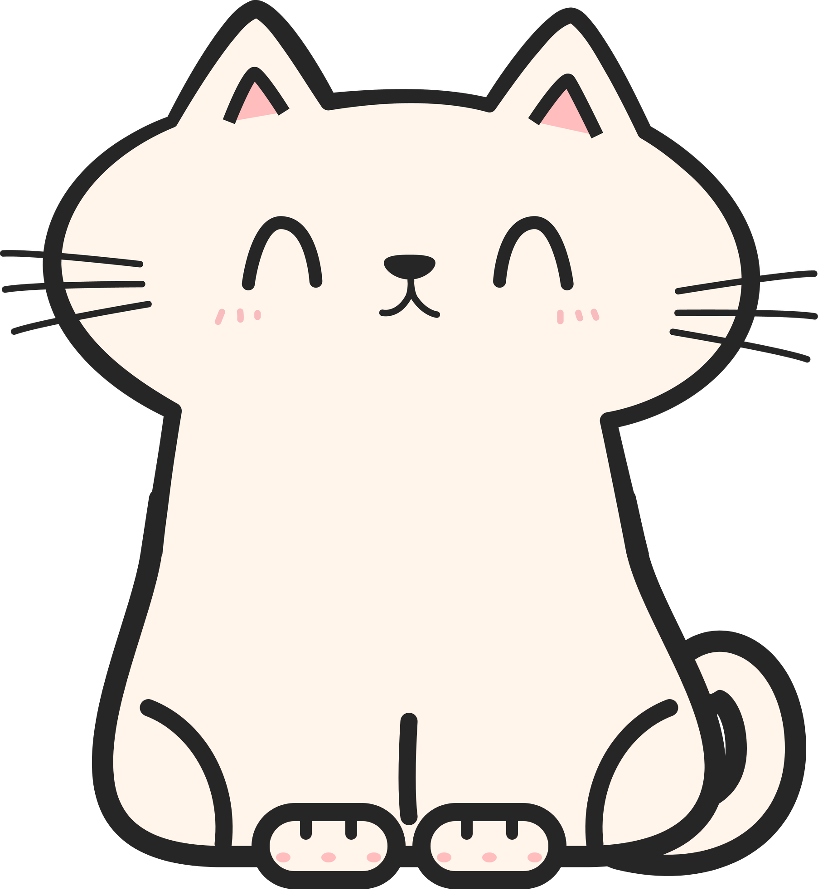

<h1 align="center">MeawCat</h1>

<p align="center">
  
</p>

<p align="center">
  A cute desktop cat that peeks out from behind your Windows taskbar, and also helps you study, plan and stay organized.
</p>

<p align="center">
  
  
  
  
</p>

## What is it?

MeawCat is a desktop pet and personal assistant in one. The cat sits behind the taskbar next to the clock, pops up when you move the mouse, and its eyes follow your cursor. Behind the cute face is a full assistant: local AI chat, reminders, to-do list, study tracker, sticky notes, weather alerts, YouTube music and 8 mini games.

The cat, the kitten, all animations and even the cat sounds are drawn or generated by code. The only image needed is `cat.png`.

## Why?

- **A friendlier daily routine** for students: reminders, tasks, exam countdown and study streaks in one place.
- **Private by design:** the AI runs on your own computer and the screen reader is offline.
- **Accessible:** every sound alert also has a visual one (speech bubble and Windows notification), and the AI uses short, simple sentences.

## Features

**The cat**
- Peeks from the taskbar, eyes follow the mouse, blinks
- Pick it up and throw it; it lands on windows and rides along with them
- 18 moods that react to you (happy, sleepy at night, sad on low battery, and more)
- Feed it fish or milk, taskbar strolls, good night routine, a visiting kitten
- Reacts to the apps you open (VS Code, Word, Spotify, games...)

**Assistant**
- **AI chat** with a local model (Ollama). It can also act: *"remind me Friday at 8pm to submit the lab"*, *"start a 25 minute timer"*, *"add buy ink to my to-do list"*
- **Reminders** from plain sentences: `in 20 minutes drink water`, `every weekday at 9:30 stand-up`
- **To-do list** with due dates (`@tomorrow`, `@fri`, `@2026-11-05`)
- **Study tracker** with exam countdown, daily goal, streak and study timer
- **Calendar import** from `.ics` files (Google Calendar, Outlook, timetables)
- **Sticky notes** in 7 colours, pinnable, searchable
- **Timer** with presets and a 25-minute focus option
- **Read text from screen** with offline Windows OCR, then explain, summarize or translate it
- **Weather** with rain alerts and an umbrella for the cat
- **YouTube music** (sound only) while the cat sings along
- **Do not disturb**, and **Start with Windows**

**Cat Arcade:** Rock Paper Scissors, Catch the Treats, Cup Game, Memory Match, Whack-a-Mouse, Typing Race, Quick Maths and Snake. Best scores are saved.

## Requirements

- Windows 10 or 11 and Python 3.9+
- `PySide6` (required)
- [Ollama](https://ollama.com) with a model such as `llama3.2` (only for AI chat)
- `yt-dlp` plus Deno or Node.js (only for YouTube music)

Every extra feature lives in its own file. If one is missing or broken, the cat still starts and the reason is written to `cat_error.log`.

## Setup

1. **Install Python** from [python.org](https://www.python.org/downloads/) and tick **"Add python.exe to PATH"**.
2. **Get the project:** click **Code → Download ZIP** on this page and unzip it.
3. **Open PowerShell in the project folder** and install the packages:
   ```powershell
   pip install -r requirements.txt
   ```
4. **Run the cat:**
   ```powershell
   python Main_file.pyw
   ```
   You can also double-click `Main_file.pyw`. Right-click the cat or the tray icon (near the clock) to open the menu.

**Optional**
- **AI chat:** install Ollama, run `ollama pull llama3.2`, then tray menu → *Chat with the cat*.
- **YouTube music:** run `winget install DenoLand.Deno` (or install Node.js), and keep yt-dlp updated with `pip install -U "yt-dlp[default]"`.
- **Autostart:** tray menu → *Start with Windows*.

## How to use

| Action | Result |
| --- | --- |
| Move the mouse | The cat pops up and follows your cursor |
| Click the cat | Pets it |
| Drag the cat, then let go | Throws it; it falls |
| Double-click the tray icon | Opens Reminders |
| Right-click the cat or tray icon | Opens the menu |
| `Enter` / `Shift+Enter` / `Esc` in chat | Send / new line / stop the answer |

## Project structure

```
Main_file.pyw      Entry point: the cat, tray menu, moods, reminders, timer
ai_assistant.py    Local AI backend (Ollama): streaming and tool calling
cat_features.py    To-do, study tracker, calendar import, sounds, app reactions
cat_motion.py      Pick up, throw, land on windows
mini_game.py       Cat Arcade (8 games)
notes.py           Sticky notes
screen_ocr.py      Read text from screen (Windows OCR)
weather.py         Weather and rain alerts (Open-Meteo)
kitten.py          The visiting kitten
youtube_music.py   Sound-only YouTube player
cat.png            The cat picture
```

Your data is saved as JSON files next to `Main_file.pyw` (`settings.json`, `reminders.json`, `notes.json`, `todos.json`, `study.json`, `chat_history.json`). 

## Privacy

- AI chat and screen reading run on your computer; nothing is sent to the internet.
- App and YouTube reactions only read the program name or window title. Nothing is stored or sent.
- Weather sends only the latitude and longitude of your city to [open-meteo.com](https://open-meteo.com).
- YouTube music contacts YouTube to search and stream, like any YouTube player.

## Skills and technologies

- **Python:** OOP, threading, regular expressions, JSON, graceful error handling
- **PySide6 / Qt:** custom `QPainter` drawing, animation, transparent click-through windows, system tray, signals and slots, QtMultimedia
- **Windows integration:** Win32 API through `ctypes`, registry, WinRT OCR through PowerShell, notifications
- **Local AI:** Ollama streaming, cancellation, token-budgeted history, tool calling
- **Parsing:** natural-language reminders, iCalendar (`.ics`) with recurrence rules
- **APIs and media:** Open-Meteo REST API, `yt-dlp`, procedural audio synthesis
- **Game development:** 8 mini games with scoring and effects
- **Accessibility:** visual alternatives to sounds, simple language

## Troubleshooting

| Problem | Fix |
| --- | --- |
| Nothing happens | Run `python Main_file.pyw` in PowerShell and check `cat_error.log` |
| `No module named PySide6` | `pip install PySide6` |
| A menu item is missing | That module failed to load; see `cat_error.log` |
| "I can't reach Ollama" | Start the Ollama app, then ask again |
| YouTube music will not play | `pip install -U "yt-dlp[default]"` and install Deno or Node.js |
| Cannot see the cat | Tray menu → *Call the cat home*, and check *Pause cat* is off |

## License
Free for personal and other non-commercial use under the PolyForm Noncommercial License 1.0.0. Selling it, or using it in a paid product or service, needs separate permission from the author.
